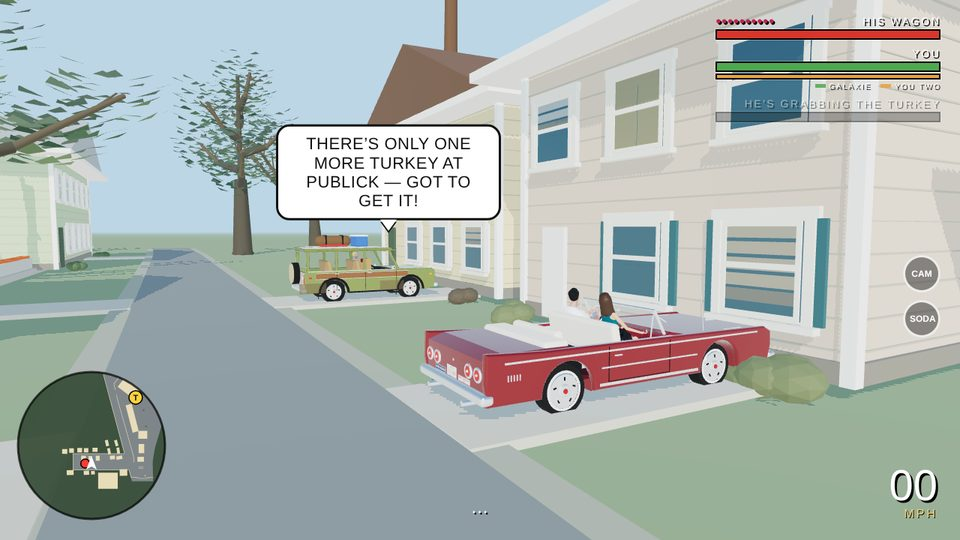
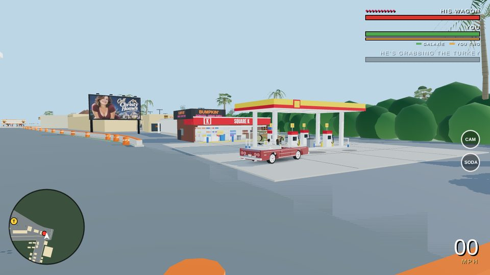
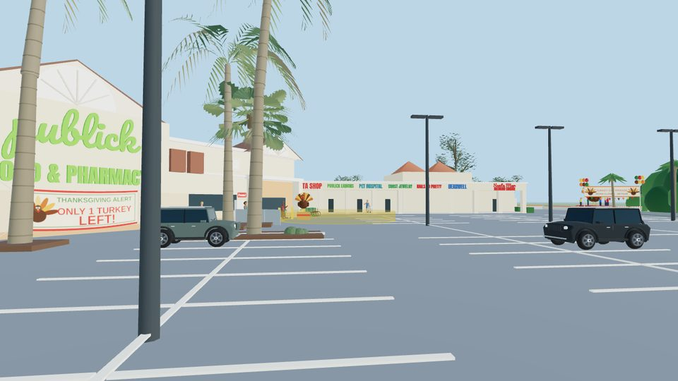
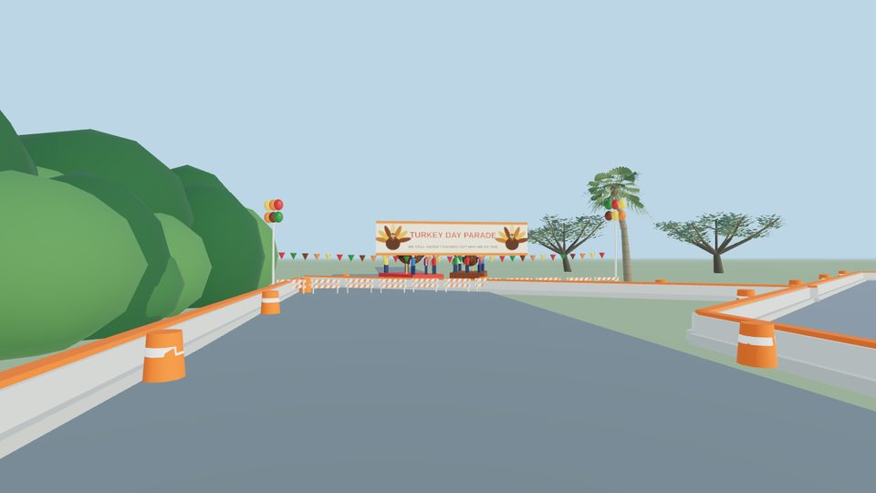

# The Last Turkey

| | |
|---|---|
|  |  |
|  |  |

A small GTA-style Thanksgiving driving game in three.js, set in the beach town of Saint Ponce, Florida (a parody of St. Augustine Beach), around Ponce Plaza.

Chris and his wife are in a red '64 Ford Galaxie convertible. Phillip, the neighbor, is in his wood-sided wagon. Both of them back out of their driveways on Floridian Ave at the same moment, racing for the **last turkey at publick**. Ram his wagon before he grabs it. He throws cranberry-sauce cans; she throws soda cans back.

**Play it:** https://claude.ai/artifact/Vfm8Ejmcw49qu9zt6PdG7i

## Controls

| | Keyboard | Touch |
|---|---|---|
| Gas / brake & reverse | W / S | GAS / BRAKE |
| Steer | A / D | ◀ / ▶ |
| Handbrake | Space | |
| Throw soda | F | SODA |
| Camera | V, drag to orbit, mouse wheel or Ctrl +/− to zoom | CAM, drag, pinch |
| Horn / sound / restart | H / M / R | |
| Show these controls | hold Ctrl, or the KEYS button | |

## Rules

- Phillip won't ram you until you ram him first.
- He has 10 cranberry cans. He always saves the last one for after his wagon is wrecked. Seven hits and you two are done.
- She gets 3 soda cans after his first throw.
- The Galaxie is tough, but it does take damage from walls and crashes.
- You have to go around the gas station to reach the store.

## Project layout

- `src/main.js`: the game (driving physics, collisions, Phillip's AI, cans, HUD, cameras)
- `src/car.js`: the code-built Galaxie and wagon
- `src/station.js`: Square K, Bumpkin' Donuts, Bank of the Gulf of America, Megabucks, The OOPS Store and the other dressing
- `src/plaza-data.json`: walls, driveways, homes and other layout data exported with the world
- `dist/assets/`: models (the plaza world, Chris from [Truck-Animation](https://github.com/chrislanejones/Truck-Animation), her from [pga-golf-game](https://github.com/chrislanejones/pga-golf-game))
- `pub/`: the built, playable page
- `tools/`: the world exporter and headless test scripts

## Build

```sh
npm install
./build.sh          # bundles src/ and wraps the models as base64 modules into pub/
tools/serve.sh      # serves pub/ on http://localhost:8765
```

The models are wrapped as base64 JS modules because the artifact host won't serve `.glb` or `.fbx` files.

`tools/export-plaza.ts` rebuilds `dist/assets/plaza.glb` and `src/plaza-data.json` from [3d-world](https://github.com/chrislanejones/3d-world). It expects that repo checked out at `/home/claude/3d-world`, so change the import paths to match your machine. Afterward, compress the export with `npx gltf-transform meshopt`.

All business names are parodies.
